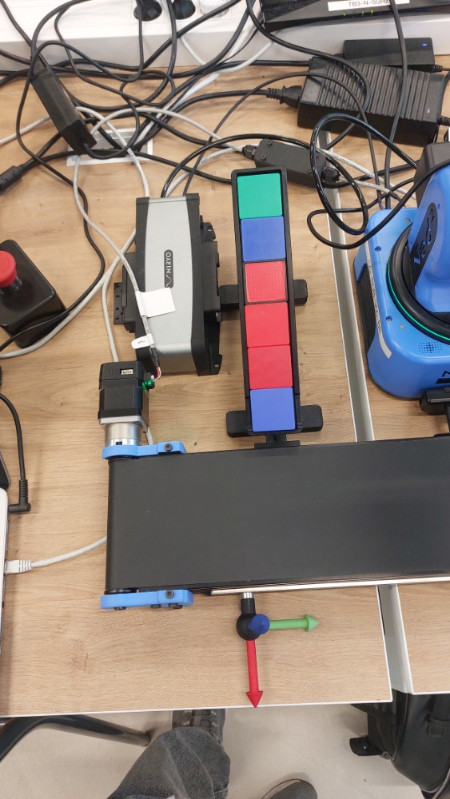
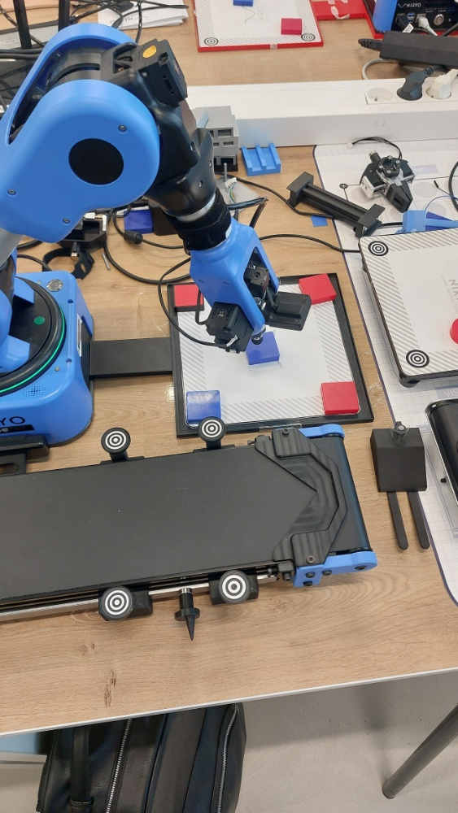
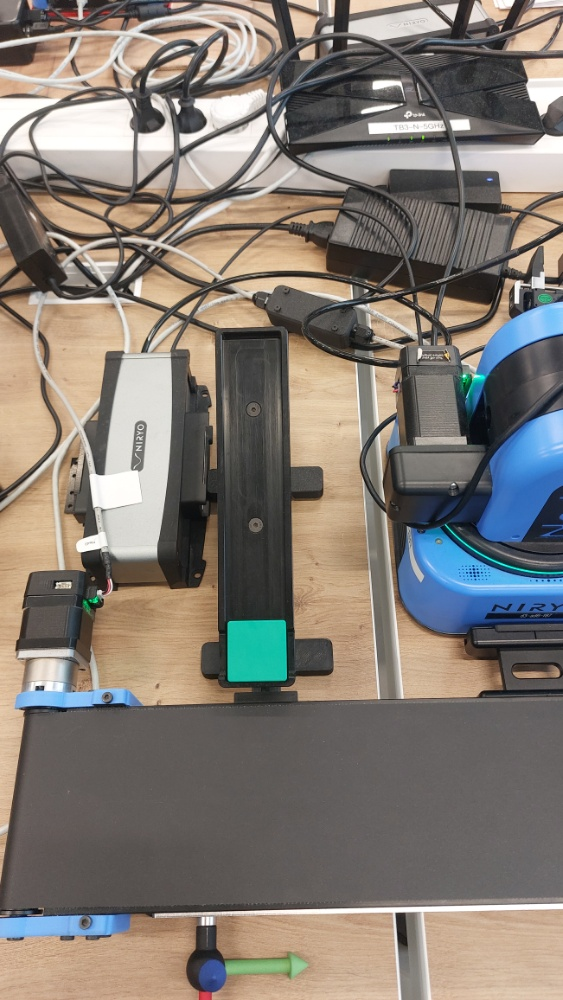

# Démonstration Automatisée – Bras Robotisé Niryo Ned2

Projet de démonstration technique visant à appréhender le pilotage, la programmation et l'intégration d'un bras robotisé collaboratif **Niryo Ned2** équipé d'un convoyeur (tapis roulant) et d'un distributeur gravitationnel

---

## Objectifs pédagogiques et compétences acquises

* **Configuration réseau :** Paramétrage d'une liaison directe Ethernet avec adressage statique **IPv4** (`169.254.200.200`) pour la communication avec le contrôleur du robot.
* **Mise en service et tests matériels :** Calibrage automatique des axes, détection et pilotage de l'outil (pince), test et commande du convoyeur via bus de communication.
* **Cinématique et trajectoires :** Apprentissage et manipulation des repères du robot :
  * Gestion des **joints** (angles des 6 axes) et des **poses** cartésiennes `(x, y, z, roll, pitch, yaw)`
  * Création de points de passage intermédiaires pour sécuriser les trajectoires et éviter les collisions.
* **Développement Python :** Automatisation complète d'un cycle industriel autonome à l'aide de la bibliothèque officielle **PyNiryo**.

---

## Fonctionnement du cycle de démonstration

Le programme exécute en continu (`while True`) un cycle complet d'approvisionnement et de rangement autonome :

1. **Phase 1 – Distribution (Aller ordonné) :**
   * Le robot prélève un pion à la sortie basse du distributeur vertical (`PICK_POSE`)
   * Il le dépose sur le convoyeur, qui l'achemine jusqu'à la zone de travail
   * Le robot récupère le pion en bout de tapis et le place successivement sur 5 emplacements définis du *workspace* (`pos1` à `pos5`)

2. **Phase 2 – Rangement (Retour aléatoire) :**
   * L'ordre des 5 positions est mélangé aléatoirement (`random.shuffle`) à chaque cycle.
   * Le robot vient récupérer chaque pion sur le *workspace* dans cet ordre aléatoire et le réinjecte directement par le haut du distributeur (`RETURN_POSE`) pour recharger le système par gravité

---

## Aperçu du dispositif

| Distributeur rempli | Dépôt sur le workspace | Fin de cycle et rechargement |
| :---: | :---: | :---: |
|  |  |  |

---

## Technologies et prérequis

* **Matériel :** Robot Niryo Ned2, pince adaptative, convoyeur Niryo, distributeur de pions[cite: 13, 14].
* **Langage :** Python 3
* **Bibliothèque :** `pyniryo` (`pip install pyniryo`)
* **Réseau :** Carte réseau configurée en IPv4 statique sur le même sous-réseau que le robot (`169.254.200.x`).

---

## Lancement du projet

1. Connecter le PC au robot via câble Ethernet et vérifier le `ping` vers `169.254.200.200`.
2. Remplir le magasin vertical avec les 5 pions[cite: 13].
3. Exécuter le script principal :
   ```bash
   python main.py
4. Appuyer sur `Ctrl + C` dans le terminal pour déclencher l'arrêt propre (arrêt du convoyeur, retour en position initiale et fermeture de la connexion).